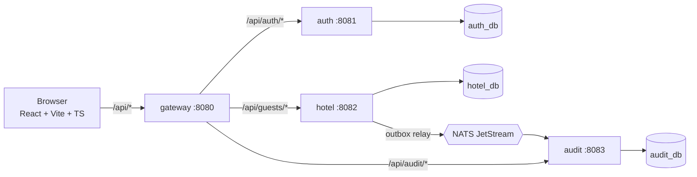

# Архитектура: «Записная книжка отеля»

Статус: черновик на согласование. Этап: system design. Код пока не пишется.

## 1. Цели и границы

Функционально (из ТЗ): регистрация и вход, CRUD по записям гостей (ФИО, телефон, номер, дата заезда, дата выезда, заметка), поиск по записям, веб-интерфейс.

Нефункционально:
- запуск одной командой (`docker compose up`), миграции одной командой, тесты одной командой;
- пароли хранятся только хешем (bcrypt), без валидного токена данные недоступны (401);
- единый формат ошибок, валидация на входе, структурные логи, graceful shutdown;
- осознанно выбранный уровень «сверх ТЗ»: микросервисы, gateway, асинхронный аудит через NATS.

Вне рамок: RBAC, мультитенантность, бронирование номеров и расчёт занятости, отправка уведомлений.

Модель доступа: **общая книга отеля**. Все авторизованные пользователи видят и меняют одни и те же записи. Поле `owner_id` не нужно. Кто что сделал, фиксируется в аудите через `actor_id`.

## 2. Компоненты



| Сервис | Ответственность | Хранилище | Наружу |
|---|---|---|---|
| gateway | единая точка входа, проверка JWT, rate limit, CORS, request-id, проксирование | нет | :8080 |
| auth | пользователи, пароли (bcrypt), выпуск и ротация токенов | `auth_db` | только через gateway |
| hotel | CRUD гостей, поиск, публикация событий (outbox) | `hotel_db` | только через gateway |
| audit | потребитель событий, журнал изменений, чтение журнала | `audit_db` | только через gateway |
| frontend | SPA, раздаётся nginx, `/api` проксируется на gateway | нет | :3000 |

Правила взаимодействия:
- Сервисы не ходят в чужие БД и не импортируют код друг друга. Общее только в `pkg/`.
- Синхронно сервисы друг друга не вызывают. Единственная связь между доменными сервисами идёт через события.
- В публичный доступ из compose выставлены только `gateway` и `frontend`. Остальные порты доступны внутри сети compose.

## 3. Структура репозитория

```
ovk-system-hotel/
├── backend/
│   ├── go.work
│   ├── pkg/                      # отдельный go.mod, только инфраструктурный код
│   │   ├── jwtx/                 # подпись и проверка токена за интерфейсом
│   │   ├── httpx/                # middleware, RFC 7807, request-id, recover
│   │   ├── logx/                 # slog-конфигурация
│   │   ├── config/               # env-конфиг
│   │   └── natsx/                # обёртки публикации и подписки
│   └── services/
│       ├── auth/    {go.mod, cmd/auth, internal/{transport/http,service,repository,domain}, migrations, Dockerfile}
│       ├── hotel/   {то же + internal/outbox}
│       ├── audit/   {то же + internal/consumer}
│       └── gateway/ {go.mod, cmd/gateway, internal/{proxy,ratelimit}, Dockerfile}
├── frontend/                     # Vite + React + TS, Dockerfile (nginx)
├── deploy/
│   ├── docker-compose.yml
│   └── postgres/init.sql         # создание БД и ролей
├── api/                          # OpenAPI-спеки (auth.yaml, hotel.yaml, audit.yaml)
├── docs/                         # architecture.md и ADR
├── .env.example
├── Makefile
└── README.md
```

Слои внутри сервиса: `transport/http (package transporthttp, chi) → service (бизнес-логика) → repository (pgx)`. Интерфейсы объявляются на стороне потребителя, чтобы service-слой тестировался без БД.

## 4. Данные

### 4.1 auth_db

```sql
CREATE TABLE users (
  id            uuid PRIMARY KEY,
  email         text NOT NULL,
  password_hash text NOT NULL,                -- bcrypt, cost 12
  created_at    timestamptz NOT NULL DEFAULT now()
);
CREATE UNIQUE INDEX users_email_uq ON users (lower(email));

CREATE TABLE refresh_tokens (
  id          uuid PRIMARY KEY,
  user_id     uuid NOT NULL REFERENCES users(id) ON DELETE CASCADE,
  token_hash  bytea NOT NULL,                 -- sha256 от токена, сам токен не хранится
  family_id   uuid NOT NULL,                  -- для обнаружения повторного использования
  expires_at  timestamptz NOT NULL,
  revoked_at  timestamptz,
  created_at  timestamptz NOT NULL DEFAULT now()
);
CREATE UNIQUE INDEX refresh_tokens_hash_uq ON refresh_tokens (token_hash);
CREATE INDEX refresh_tokens_user_idx ON refresh_tokens (user_id);
```

Ротация refresh: при обмене старый токен помечается `revoked_at`, выдаётся новый в той же `family_id`. Предъявление уже отозванного токена отзывает всю семью.

### 4.2 hotel_db

```sql
CREATE EXTENSION IF NOT EXISTS pg_trgm;

CREATE TABLE guests (
  id          uuid PRIMARY KEY,
  full_name   text NOT NULL CHECK (char_length(full_name) BETWEEN 1 AND 200),
  phone       text NOT NULL,                    -- E.164
  room        text NOT NULL CHECK (char_length(room) BETWEEN 1 AND 20),
  check_in    date NOT NULL,
  check_out   date NOT NULL,
  note        text NOT NULL DEFAULT '' CHECK (char_length(note) <= 2000),
  created_by  uuid NOT NULL,                    -- user id из JWT, без FK на чужую БД
  created_at  timestamptz NOT NULL DEFAULT now(),
  updated_at  timestamptz NOT NULL DEFAULT now(),
  CONSTRAINT guests_dates_chk CHECK (check_out >= check_in)
);

-- Поиск по подстроке (ILIKE '%q%') по ФИО, телефону, номеру
CREATE INDEX guests_search_trgm_idx ON guests
  USING gin ((full_name || ' ' || phone || ' ' || room) gin_trgm_ops);
-- Ключ курсорной пагинации списка
CREATE INDEX guests_created_idx ON guests (created_at DESC, id DESC);
-- Выборки по датам заезда и выезда
CREATE INDEX guests_check_in_idx ON guests (check_in);

CREATE TABLE outbox (
  id           bigserial PRIMARY KEY,
  event_id     uuid NOT NULL UNIQUE,
  subject      text NOT NULL,                   -- guest.created | guest.updated | guest.deleted
  payload      jsonb NOT NULL,
  created_at   timestamptz NOT NULL DEFAULT now(),
  published_at timestamptz
);
CREATE INDEX outbox_unpublished_idx ON outbox (id) WHERE published_at IS NULL;
```

Обоснование индексов:
- GIN с триграммами нужен, потому что поиск по подстроке не использует btree. Без него при росте таблицы будет seq scan.
- Выражение `full_name || ' ' || phone || ' ' || room` позволяет искать одним запросом по трём полям. Запрос должен использовать то же выражение.
- Частичный индекс `outbox_unpublished_idx` держит маленьким набор строк, которые читает relay.

### 4.3 audit_db

```sql
CREATE TABLE audit_log (
  id          bigserial PRIMARY KEY,
  event_id    uuid NOT NULL UNIQUE,              -- идемпотентность потребителя
  action      text NOT NULL,                     -- created | updated | deleted
  entity_id   uuid NOT NULL,
  actor_id    uuid NOT NULL,
  payload     jsonb NOT NULL,
  occurred_at timestamptz NOT NULL,
  recorded_at timestamptz NOT NULL DEFAULT now()
);
CREATE INDEX audit_entity_idx ON audit_log (entity_id, occurred_at DESC);
```

## 5. Безопасность и токены

- Пароли: bcrypt cost 12, минимальная длина 8, максимальная 72 байта (ограничение bcrypt). Сообщения о неверном логине и пароле одинаковые, чтобы не раскрывать, существует ли email.
- Access JWT: HS256, срок 15 минут, claims `sub` (user id), `iat`, `exp`, `iss=ovk-auth`. Хранится на клиенте в памяти.
- Refresh: непрозрачная случайная строка 32 байта, срок 7 дней, в БД хранится sha256. Передаётся в `HttpOnly; SameSite=Strict` cookie с `Path=/api/auth`.
- Проверка: gateway проверяет подпись и срок, затем добавляет заголовок `X-User-ID`. hotel и audit **повторно проверяют** JWT сами (defense in depth) и не доверяют заголовку.
- Общий секрет HS256 есть у auth (подпись), gateway, hotel, audit (проверка). Пакет `pkg/jwtx` скрывает алгоритм за интерфейсами `Signer` и `Verifier`, поэтому переход на EdDSA и JWKS потребует правок только в нём и конфиге.
- Rate limit на gateway: строгий на `/api/auth/login` и `/register` (защита от перебора), мягкий на остальное.
- Ответ 401 на любой запрос к защищённому маршруту без валидного токена. Публичные маршруты: register, login, refresh, healthz.

## 6. API (внешний контракт через gateway)

Формальные контракты лежат в [api/](../api): `auth.yaml`, `hotel.yaml`, `audit.yaml` (OpenAPI 3.1), общие компоненты в `common.yaml`, схема событий в `api/events/guest-event.schema.json`. Gateway проксирует пути без переписывания, поэтому внешние и внутренние пути совпадают.

Все ответы JSON. Ошибки в формате RFC 7807 (`application/problem+json`) с полями `type`, `title`, `status`, `detail`, `request_id` и для валидации массивом `errors[{field, message}]`.

| Метод и путь | Доступ | Описание | Успех |
|---|---|---|---|
| `POST /api/auth/register` | публичный | `{email, password}` | 201 `{id, email}` |
| `POST /api/auth/login` | публичный | `{email, password}` | 200 `{access_token, expires_in}` + refresh cookie |
| `POST /api/auth/refresh` | cookie | ротация refresh | 200 как у login |
| `POST /api/auth/logout` | cookie | отзыв семьи токенов | 204 |
| `GET /api/guests?q=&limit=&cursor=` | токен | список и поиск | 200 `{items[], next_cursor}` |
| `POST /api/guests` | токен | создание | 201 гость |
| `GET /api/guests/{id}` | токен | чтение | 200 |
| `PUT /api/guests/{id}` | токен | полное обновление | 200 |
| `DELETE /api/guests/{id}` | токен | удаление | 204 |
| `GET /api/audit?entity_id=&limit=&cursor=` | токен | журнал изменений | 200 |
| `GET /healthz`, `/readyz` | служебные | liveness и readiness | 200 |

Коды ошибок: 400 (битый JSON), 401 (нет или невалидный токен), 404, 409 (email занят), 422 (валидация), 429 (rate limit), 500 без деталей наружу.

Валидация гостя: ФИО 1-200 символов, телефон приводится к E.164, номер 1-20 символов, `check_out >= check_in`, заметка до 2000 символов. Валидация дублируется на фронте для UX, но источником истины остаётся бэкенд.

Пагинация: курсор на `(created_at, id)`, значение base64. Лимит по умолчанию 20, максимум 100. Поиск `q` экранирует `%`, `_` и `\` перед подстановкой в `ILIKE`.

## 7. События

Транспорт: NATS JetStream, стрим `GUESTS`, subjects `guest.created|updated|deleted`.

```json
{
  "event_id": "uuid",
  "type": "guest.updated",
  "occurred_at": "RFC3339",
  "actor_id": "uuid",
  "entity_id": "uuid",
  "data": { "... снимок гостя ..." }
}
```

Надёжность:
1. hotel пишет изменение гостя и строку в `outbox` в одной транзакции.
2. Relay (горутина в hotel) читает неопубликованные строки через `SELECT ... FOR UPDATE SKIP LOCKED`, публикует в JetStream с `Nats-Msg-Id = event_id` и ставит `published_at`.
3. audit вычитывает durable-консьюмером с ручным ack. Дубликаты отбрасываются по `UNIQUE(event_id)` (`ON CONFLICT DO NOTHING`).
4. Итого: доставка at-least-once, эффект exactly-once за счёт идемпотентности. Недоступность NATS не ломает запись гостей, события накапливаются в outbox.

## 8. Конфигурация и запуск

- Конфиг только через env, у каждой переменной значение по умолчанию либо явная ошибка при старте. Все переменные перечислены в `.env.example`.
- `docker compose up --build` поднимает: postgres, nats, migrate-джобы (goose, по одной на сервис, выполняются до старта сервисов), auth, hotel, audit, gateway, frontend.
- Для каждого сервиса действует свой Postgres-пользователь с доступом только к своей БД.
- Healthcheck у postgres, nats и каждого сервиса. `depends_on` с `condition: service_healthy`.
- Makefile: `make up`, `make down`, `make migrate`, `make test`, `make lint`, `make e2e`.
- Миграции применяются одной командой `make migrate`. В compose они также запускаются автоматически.

## 9. Наблюдаемость и надёжность

- Логи: `slog` в JSON, поля `service`, `request_id`, `user_id`, `latency_ms`. Gateway генерирует `X-Request-ID` и пробрасывает его вниз.
- Таймауты HTTP-сервера и клиента, лимит размера тела запроса (1 МБ).
- Graceful shutdown по SIGTERM: остановка приёма, дожидание активных запросов, остановка relay и консьюмера, закрытие пула.
- Пул `pgxpool` с ограничением соединений на сервис.
- Метрики Prometheus (`/metrics`, RED-метрики HTTP, размер очереди outbox) подключаются как задача из блока «максимум». Они не блокируют базовую приёмку.

## 10. Тестирование

| Уровень | Что проверяем | Инструмент |
|---|---|---|
| unit | валидация гостя, хеш и проверка пароля, выпуск и проверка JWT, ротация refresh, кодирование курсора | `testing`, табличные тесты |
| integration | репозитории и поиск на реальном Postgres, outbox relay, консьюмер audit | testcontainers-go |
| e2e (smoke) | register → login → без токена 401 → CRUD → поиск → запись в аудите | скрипт на Go или `curl` поверх compose, `make e2e` |
| frontend | форма гостя, список и поиск, обработка 401 и refresh | Vitest + Testing Library |

`make test` запускает unit и integration. Для integration нужен Docker, это будет указано в README.

## 11. Frontend

- Стек: React, Vite, TypeScript, React Router, TanStack Query, react-hook-form + zod.
- Экраны: вход и регистрация, список гостей с поиском (debounce 300 мс) и пагинацией, форма создания и редактирования, подтверждение удаления, журнал изменений гостя.
- Access-токен в памяти, при 401 один раз пробует refresh и повторяет запрос, при неудаче уводит на страницу входа.
- Ошибки валидации бэкенда (`errors[]`) отображаются под соответствующими полями.

## 12. ADR (ключевые решения)

| № | Решение | Почему | Цена |
|---|---|---|---|
| 1 | Монорепо, а не набор репозиториев | один `docker compose up`, единая история коммитов, простая приёмка | общий CI, дисциплина границ |
| 2 | Отдельный `go.mod` на сервис и `go.work` | независимость модулей, явные зависимости | больше шаблонного кода |
| 3 | Gateway как отдельный сервис | единая точка входа, rate limit и проверка JWT в одном месте | лишний хоп и компонент |
| 4 | Одна Postgres, БД и роль на сервис | граница данных соблюдена, лёгкий запуск | общая точка отказа (для прода был бы кластер на сервис) |
| 5 | HS256 с общим секретом | выбор заказчика, проще конфигурация | секрет у всех сервисов, см. раздел 5 |
| 6 | Refresh в HttpOnly cookie, access в памяти | защита от кражи через XSS | нужны CORS и cookie-настройки |
| 7 | NATS JetStream вместо Kafka | лёгкий запуск, достаточно для масштаба задачи | меньше экосистема |
| 8 | Transactional outbox | запись и событие атомарны, нет потери событий | relay и дополнительная таблица |
| 9 | goose для миграций | простые SQL-файлы, команда `goose up` | |
| 10 | Общая книга без `owner_id` | уточнение заказчика | любой пользователь может править любую запись, смягчается аудитом |
| 11 | Триграммный GIN-индекс для поиска | `ILIKE '%q%'` не использует btree | индекс занимает больше места и замедляет запись |
| 12 | Курсорная пагинация | стабильна при вставках, не деградирует на больших смещениях | нет перехода на произвольную страницу |

## 13. Риски и что откладываем

Откладываем (будет указано в README): RBAC и роли, подтверждение email, сброс пароля, блокировка аккаунта после серии неудачных входов, EdDSA и ротация ключей, Prometheus и трейсинг, отдельные Postgres на сервис, Kubernetes-манифесты, e2e-тесты фронтенда в браузере.

Риски:
- Количество компонентов выросло относительно ТЗ, проверяющему нужно запустить 8 контейнеров. Снижаем healthcheck-ами, автоматическими миграциями и понятным README.
- Testcontainers требует Docker на машине проверяющего. Смягчаем тем, что unit-тесты без Docker запускаются отдельной командой `make test-unit`.

## 14. План этапов

1. Скелет: структура каталогов, `go.work`, `pkg/`, compose с postgres и nats, Makefile, `.env.example`.
2. Контракты: OpenAPI для auth, hotel, audit, схема событий.
3. auth: миграции, регистрация и вход, JWT, refresh, тесты.
4. hotel: миграции, CRUD, поиск, outbox, тесты.
5. gateway: проксирование, проверка JWT, rate limit.
6. audit: консьюмер, журнал, API чтения.
7. frontend.
8. e2e, CI, README (запуск, что не успели, что сделали бы иначе).
